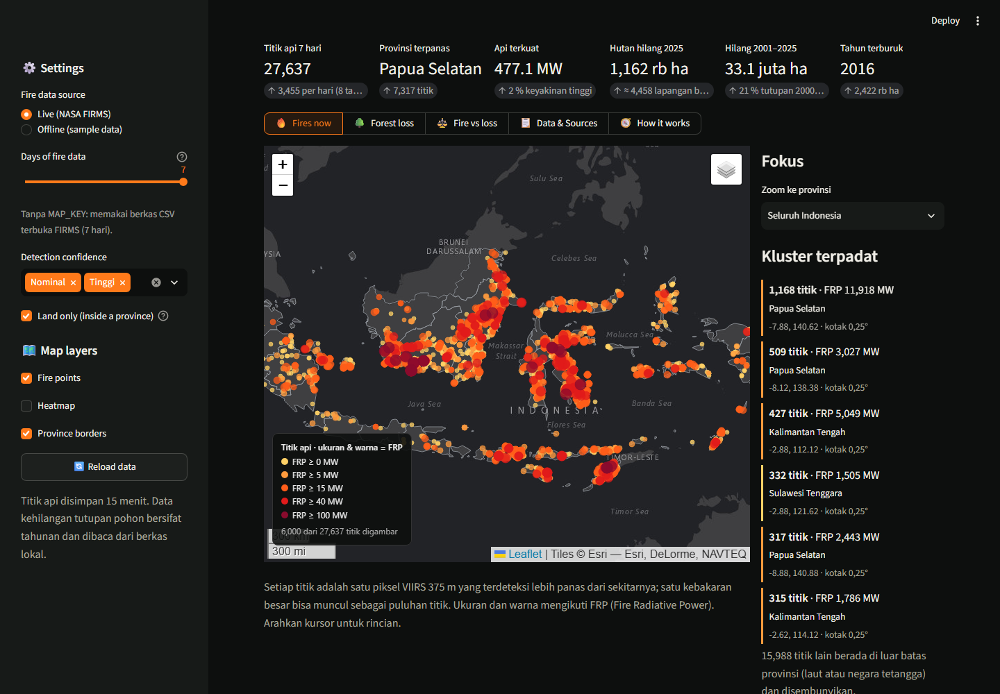
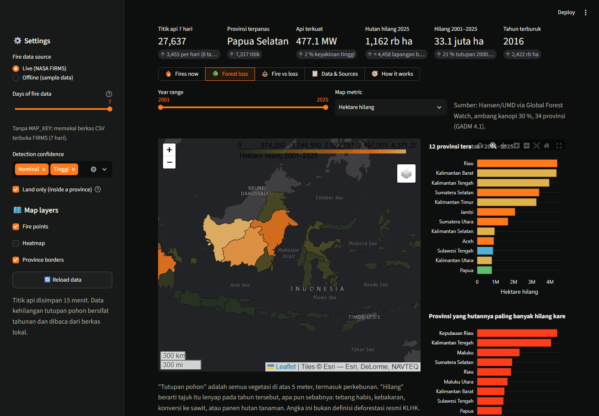
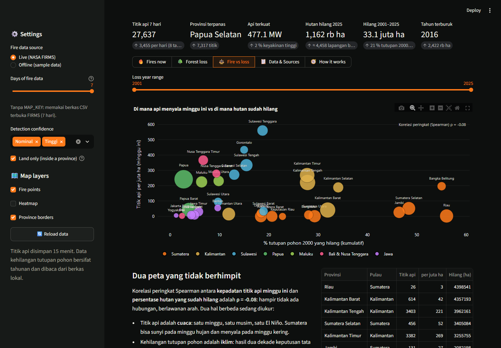
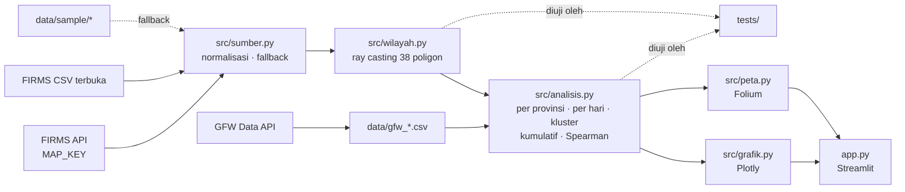

# 🔥 The Burning Archipelago

> **First the smoke, then the silence.**
> Peta titik api satelit **NASA FIRMS** minggu ini dan kehilangan tutupan pohon dua dekade dari **Global Forest Watch**
> (Hansen/UMD) di 38 provinsi Indonesia, per tahun dan per provinsi. Dibangun dengan Python, pandas, numpy, Streamlit,
> Folium, dan Plotly.

*A live map of Indonesia's satellite fire detections this week, laid over two decades of tree cover loss by province
and year. Which provinces are burning now, which ones already lost their forest, and how little the two maps overlap.
Works offline with a bundled sample dataset.*

**🚀 Coba langsung di browser:** [burning-archipelago.streamlit.app](https://burning-archipelago.streamlit.app)



> ⚠️ **Disclaimer.** Aplikasi ini menampilkan ulang data publik untuk tujuan edukasi dan portofolio. Ia **bukan sistem
> pemantauan resmi**, tidak berafiliasi dengan NASA, Global Forest Watch/WRI, KLHK, maupun BNPB, dan tidak boleh dipakai
> untuk keputusan operasional. Titik api adalah anomali termal yang belum diverifikasi; "tutupan pohon" bukan padanan
> "hutan" menurut hukum Indonesia. Rujuk ke [sipongi.menlhk.go.id](https://sipongi.menlhk.go.id/) dan
> [globalforestwatch.org](https://www.globalforestwatch.org/).

## Latar belakang

Setiap musim kemarau, satelit NASA menghitung ribuan piksel panas di atas Sumatra, Kalimantan, dan Papua. Setiap April,
Universitas Maryland merilis peta tahunan tajuk pohon yang lenyap. Keduanya terbuka untuk umum, tetapi jarang dibaca
berdampingan: yang satu berbicara dalam hitungan hari, yang lain dalam hitungan dekade. Proyek ini menaruh keduanya di
satu layar dan mengajukan pertanyaan sederhana: **apakah provinsi yang terbakar minggu ini adalah provinsi yang hutannya
sudah habis, atau justru provinsi yang hutannya masih ada?**

## Fitur

| Halaman | Isi |
|---|---|
| 🔥 Fires now | Peta Folium gelap dengan titik api 7 hari terakhir (ukuran dan warna = FRP), heatmap, batas provinsi dengan jumlah titik, zoom per provinsi, kluster 0,25° terpadat, titik per provinsi dan per juta hektare, titik per hari dan per jam, tingkat keyakinan, sebaran FRP |
| 🌳 Forest loss | Koroplet 34 provinsi untuk rentang tahun pilihan (hektare, % tutupan 2000, atau emisi CO₂e), provinsi teratas, porsi kehilangan akibat kebakaran, kehilangan nasional 2001–2025 bertumpuk kebakaran vs lainnya, kurva kumulatif, gelombang per pulau, perbandingan provinsi |
| ⚖️ Fire vs loss | Sebaran kepadatan titik api minggu ini vs persen tutupan yang hilang per provinsi, korelasi peringkat Spearman, tabel gabungan |
| 📋 Data & Sources | Tabel titik api dan tabel kehilangan per provinsi per tahun, unduh CSV, sumber, disclaimer |
| 🧭 How it works | Alur data dari CSV satelit sampai peta |

Kartu KPI di atas: titik api dan rata-rata per hari, provinsi terpanas, api terkuat, hutan hilang tahun terakhir
dalam lapangan sepak bola per hari, total 2001–2025 dalam kelipatan luas Jakarta, dan tahun terburuk.




## Cara menjalankan

```bash
git clone https://github.com/Avalon2222/burning-archipelago.git
cd burning-archipelago
python -m venv .venv && source .venv/bin/activate   # Windows: .venv\Scripts\activate
pip install -r requirements.txt
streamlit run app.py
```

Buka `http://localhost:8501`. Tanpa pengaturan apa pun, titik api diambil dari berkas CSV terbuka FIRMS (7 hari
terakhir) dan disimpan 15 menit. Jika jaringan gagal, aplikasi memakai data contoh di `data/sample/` dan menampilkan
spanduk peringatan; mode offline juga bisa dipilih di sidebar.

**MAP_KEY (opsional).** Kunci gratis dari [firms.modaps.eosdis.nasa.gov/api/map_key](https://firms.modaps.eosdis.nasa.gov/api/map_key/)
membuka API resmi (1–10 hari, arsip sejak 2012). Salin `.streamlit/secrets.toml.example` ke `.streamlit/secrets.toml`
dan isi `map_key`; berkas itu ada di `.gitignore`. Di Streamlit Community Cloud, tempel isi yang sama di *Settings →
Secrets*.

Pengujian: `python -m pytest tests/ -v` (37 tes, tanpa jaringan). Perbarui data contoh dan tabel GFW:
`python scripts/perbarui_sample.py`.

## Sumber data

| Sumber | Isi | Format |
|---|---|---|
| [NASA FIRMS](https://firms.modaps.eosdis.nasa.gov/) VIIRS 375 m, NOAA-20 & NOAA-21 | Titik api hampir seketika; berkas regional 7 hari tanpa kunci, API dengan MAP_KEY | CSV |
| [Global Forest Watch Data API](https://data-api.globalforestwatch.org/) (`gadm__tcl__adm1_change`, `adm1_summary`, v20260424) | Kehilangan tutupan pohon, kehilangan akibat kebakaran, dan emisi per provinsi per tahun 2001–2025; tutupan 2000/2010 (Hansen/UMD, ambang kanopi 30 %) | CSV |
| [GADM 4.1](https://gadm.org/) via GFW | Nama 34 provinsi | CSV |
| [Deny Herianto](https://github.com/denyherianto/indonesia-geojson-topojson-maps-with-38-provinces) (CC BY 4.0) | Batas 38 provinsi | GeoJSON |

Rincian metodologi, termasuk mengapa ribuan titik di Laut Arafura dibuang dan mengapa "kehilangan tutupan pohon"
bukan "deforestasi", ada di [`data/SUMBER_DATA.md`](data/SUMBER_DATA.md).

## Cara kerja (ringkas)



Beberapa gagasan inti:

- **Titik api → provinsi** memakai *ray casting* yang divektorkan numpy: sinar mendatar dari tiap titik ke kanan dipotong
  oleh sisi poligon berapa kali? Ganjil berarti di dalam. Kotak pembatas memangkas 95 % pekerjaan.
- **38 provinsi → 34 provinsi** cukup dengan menyambung daftar poligon menjadi satu MultiPolygon, karena provinsi tidak
  pernah bertumpang tindih.
- **Dua skala waktu** dipertemukan dengan menormalkan keduanya: titik per juta hektare vs persen tutupan 2000 yang hilang,
  lalu korelasi peringkat Spearman.

## Struktur proyek

```
burning-archipelago/
├── app.py                 # antarmuka Streamlit
├── src/
│   ├── sumber.py          # FIRMS (API/CSV terbuka), GFW Data API, fallback offline
│   ├── wilayah.py         # GeoJSON, ray casting, penggabungan provinsi
│   ├── analisis.py        # agregasi, kumulatif, korelasi
│   ├── grafik.py          # grafik Plotly
│   └── peta.py            # peta Folium (titik api, koroplet)
├── data/
│   ├── provinsi.geojson   # 38 provinsi
│   ├── gfw_tahunan.csv    # kehilangan per provinsi per tahun
│   ├── gfw_tutupan.csv    # luas dan tutupan 2000/2010
│   ├── sample/            # titik api 7 hari untuk mode offline dan pengujian
│   └── SUMBER_DATA.md     # sumber dan metodologi
├── scripts/perbarui_sample.py
├── tests/                 # 37 tes pytest, tanpa jaringan
└── docs/
    ├── BELAJAR.md         # panduan belajar
    ├── LATIHAN.md         # latihan bertingkat
    └── screenshots/
```

## Belajar dari proyek ini

- [`docs/BELAJAR.md`](docs/BELAJAR.md): panduan dari nol, mulai dari cara satelit "melihat" api, membaca CSV FIRMS,
  algoritma titik-dalam-poligon, menyambung GeoJSON, membaca data Hansen dengan jujur, sampai model mental Streamlit.
  Sekitar 3–4 jam.
- [`docs/LATIHAN.md`](docs/LATIHAN.md): sembilan latihan dari mengganti warna FRP sampai mengunduh arsip FIRMS satu musim
  kemarau penuh dengan MAP_KEY, masing-masing dengan petunjuk dan kunci.

## Keterbatasan

- Titik api adalah piksel panas, bukan kebakaran: jumlahnya bergantung pada ukuran api, tutupan awan, dan jam lintasan
  satelit. Api yang menyala di antara dua lintasan (sekitar 01:30 dan 13:30 waktu lokal) tidak pernah tercatat.
- Berkas terbuka FIRMS hanya 7 hari; mundur ke tahun-tahun sebelumnya membutuhkan MAP_KEY dan puluhan permintaan per tahun
  (lihat Latihan 9).
- GFW memakai 34 provinsi GADM 4.1; empat provinsi baru Papua digabung ke induknya, sehingga koroplet kehilangan tidak
  bisa memisahkan Papua Selatan dari Papua.
- "Tutupan pohon" mencakup perkebunan dan hutan tanaman; panen HTI tercatat sebagai kehilangan. Data 2011 ke atas memakai
  algoritma yang lebih peka dari 2001–2010.
- Poligon provinsi disederhanakan, sehingga titik tepat di garis pantai kadang terhitung "laut".
- Korelasi Spearman pada 34 titik data hanya alat baca, bukan bukti sebab-akibat.

## Lisensi

Kode berlisensi MIT. Data milik lembaga masing-masing dan tunduk pada ketentuan penggunaannya: NASA FIRMS (domain
publik), Hansen/UMD/GFW (CC BY 4.0), GeoJSON provinsi (CC BY 4.0).
