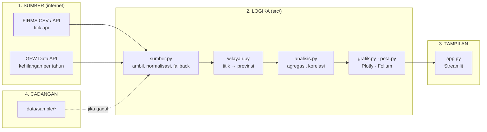

# 🎓 Panduan Belajar: Membaca Api dan Hutan dari Langit

Panduan ini untuk pembaca yang sudah bisa menjalankan skrip Python sederhana tetapi belum pernah mengolah data
satelit, menguji titik di dalam poligon, atau membuat peta interaktif. Tujuannya bukan menghafal kode, melainkan
memahami **mengapa** kodenya ditulis begitu. Bacalah sambil membuka berkas yang disebut, dan ubah sesuatu di setiap
bagian. Jika rusak, `git checkout -- .` mengembalikan semuanya.

Perkiraan waktu: 3–4 jam, boleh dibagi beberapa sesi.

---

## Bab 0 — Dua jam dinding yang berbeda

Ada dua jenis data di proyek ini, dan keduanya berdetak dengan kecepatan berbeda.

**Titik api** datang dari satelit polar (NOAA-20, NOAA-21) yang melintasi Indonesia dua kali sehari. Setiap piksel
375 m yang jauh lebih panas dari tetangganya dicatat sebagai satu baris CSV. Umurnya beberapa jam; FIRMS hanya
menyimpan berkas terbuka untuk 7 hari.

**Kehilangan tutupan pohon** datang dari ribuan citra Landsat yang diolah sekali setahun oleh Universitas Maryland
dan disebarkan Global Forest Watch. Satu angka per provinsi per tahun, sejak 2001.

Aplikasi ini menaruh keduanya berdampingan dan bertanya: apakah tempat yang terbakar **minggu ini** sama dengan
tempat yang hutannya **sudah habis**? Jawabannya mengejutkan, dan kita akan sampai ke sana di Bab 5.



**Mengapa dipisah?** Supaya setiap bagian bisa diuji sendiri. `wilayah.py` tidak tahu Streamlit ada; ia hanya menerima
koordinat dan mengembalikan nama provinsi. Itulah yang membuat 37 tes di `tests/` bisa berjalan tanpa internet dan
tanpa browser.

---

## Bab 1 — Bagaimana satelit "melihat" api (`src/sumber.py`)

### 1.1 Satu baris = satu piksel panas

Buka berkas terbuka FIRMS di browser (URL ada di `URL_CSV_TERBUKA`). Baris pertamanya kira-kira:

```
latitude,longitude,bright_ti4,scan,track,acq_date,acq_time,satellite,confidence,version,bright_ti5,frp,daynight
-2.2096,113.9213,340.5,0.4,0.6,2026-10-30,0632,N20,nominal,2.0NRT,295.0,12.34,D
```

- `bright_ti4` adalah **suhu kecerahan** pada kanal inframerah tengah (3,7 µm) dalam kelvin. Permukaan normal sekitar
  300 K; piksel ini 340 K. Api mendorong angka itu naik walau hanya mengisi 1 % piksel.
- `frp` adalah **Fire Radiative Power** dalam megawatt: energi yang dipancarkan. Ini angka terpenting untuk
  membandingkan api, karena sebanding dengan laju pembakaran biomassa.
- `confidence` memberi `low / nominal / high`. Bukan probabilitas, melainkan kelas kualitas: `low` sering muncul di
  tepi lintasan atau di permukaan panas tanpa api.
- `acq_time` ditulis `0632` tanpa titik dua, dan kadang `532` karena nol depannya hilang. Perhatikan `str.zfill(4)` di
  `normalisasi_firms`: itu pelajaran pertama tentang data nyata.

### 1.2 Satu bentuk untuk semua

```python
KOLOM_TITIK = ["waktu_utc", "lat", "lon", "frp", "kecerahan", "keyakinan", "siang_malam", "satelit", "sumber"]
```

Apa pun sumbernya (CSV terbuka, API dengan kunci, data contoh, bahkan MODIS yang kolomnya `brightness` bukan
`bright_ti4`), semuanya dipetakan ke sembilan kolom ini. Setelah itu seluruh kode lain tidak perlu tahu dari mana data
berasal. Cobalah: `python -c "from src import sumber; print(sumber.muat_sample()[0].head())"`.

### 1.3 Tiga tingkat cadangan

`muat_titik_api` mencoba berurutan: API FIRMS (bila ada MAP_KEY) → CSV terbuka → data contoh. Setiap kegagalan dicatat
di daftar `kesalahan` dan ditampilkan di aplikasi, bukan disembunyikan. Prinsipnya: **aplikasi tidak boleh mati hanya
karena satu server mati**, tetapi pengguna berhak tahu data mana yang sedang ia lihat.

### 1.4 MAP_KEY: mengapa ada kunci untuk data gratis?

NASA membatasi 5000 permintaan per 10 menit per kunci agar servernya tidak diserbu. Kuncinya gratis dan dikirim ke
email. Aplikasi membacanya dari `st.secrets["firms"]["map_key"]`, yaitu berkas `.streamlit/secrets.toml` yang ada di
`.gitignore`. **Kunci tidak pernah masuk repo.** Di Streamlit Cloud, kunci ditempel di menu Secrets. Pola ini berlaku
untuk semua rahasia: baca dari lingkungan, jangan tulis di kode.

---

## Bab 2 — Titik ini ada di provinsi mana? (`src/wilayah.py`)

Ini bab paling "matematis", dan paling memuaskan.

### 2.1 Masalahnya

Kita punya 48.000 titik (lintang, bujur) dan 38 poligon provinsi. Untuk setiap titik, kita ingin tahu ia jatuh di
poligon mana. Pustaka seperti `shapely` atau `geopandas` bisa melakukannya, tetapi keduanya berat dan menyembunyikan
idenya. Idenya cukup sederhana untuk ditulis sendiri dalam 20 baris numpy.

### 2.2 Ray casting

Tarik sinar mendatar dari titik ke arah kanan sampai tak terhingga. Hitung berapa kali sinar itu memotong sisi
poligon. **Ganjil = di dalam, genap = di luar.** Alasannya: setiap kali sinar masuk ke poligon ia harus keluar lagi,
jadi titik di luar selalu menghasilkan jumlah potongan genap.

```python
def titik_dalam_cincin(lon, lat, cincin):
    x1, y1 = cincin[:, 0], cincin[:, 1]
    x2, y2 = np.roll(x1, -1), np.roll(y1, -1)        # sisi i: (x1[i],y1[i]) → (x2[i],y2[i])
    di_dalam = np.zeros(x.shape, dtype=bool)
    for ax, ay, bx, by in zip(x1, y1, x2, y2):
        melintang = (ay > y) != (by > y)             # sisi melewati ketinggian y titik?
        x_potong = ax + (y - ay) * (bx - ax) / (by - ay)
        di_dalam ^= melintang & (x < x_potong)       # potongan di kanan titik → balik status
    return di_dalam
```

Perhatikan tiga hal:

1. `np.roll` menggeser array satu langkah sehingga sisi terakhir otomatis kembali ke simpul pertama.
2. Perulangan `for` berjalan per **sisi**, bukan per **titik**. Satu provinsi punya ratusan sisi, tetapi kita menguji
   ribuan titik sekaligus di dalam setiap iterasi. Itulah vektorisasi: biarkan numpy mengerjakan dimensi yang panjang.
3. `^=` adalah XOR: setiap potongan membalik `True`↔`False`. Ganjil berakhir `True`.

Uji dengan persegi di `tests/test_wilayah.py::test_ray_casting_persegi`, lalu dengan bentuk "C" yang cekung: titik di
rongga huruf C berada di dalam kotak pembatas tetapi di luar poligon. Ray casting menanganinya dengan benar; pengecekan
kotak pembatas saja tidak.

### 2.3 Kotak pembatas: memangkas 95 % pekerjaan

Sebelum menguji poligon Aceh terhadap 48.000 titik, `PenentuProvinsi` memeriksa dulu: titik mana yang berada di dalam
kotak (xmin, ymin, xmax, ymax) Aceh? Hanya segelintir. Ray casting lalu dijalankan pada segelintir itu saja. Total
waktu untuk 48.000 titik × 38 provinsi (ratusan poligon kecil karena pulau-pulau) hanya sekitar satu detik.

Satu lagi: `belum` menandai titik yang sudah mendapat provinsi, sehingga tidak diuji ulang. Karena provinsi tidak
bertumpang tindih, titik yang sudah masuk Riau tidak mungkin juga masuk Jambi.

### 2.4 Lubang dan pulau

GeoJSON menyimpan setiap poligon sebagai daftar cincin: cincin pertama adalah batas luar, cincin berikutnya adalah
**lubang** (misalnya danau). Titik dianggap di dalam bila ia di dalam cincin luar **dan** tidak di dalam lubang mana
pun: `dalam &= ~titik_dalam_cincin(..., c)`. MultiPolygon (provinsi kepulauan) hanyalah daftar poligon; kita uji satu
per satu.

### 2.5 Menyambung 38 provinsi menjadi 34

Global Forest Watch memakai batas GADM 4.1, yang belum mengenal Papua Selatan, Papua Tengah, Papua Pegunungan, dan Papua
Barat Daya. Untuk koroplet kehilangan, empat provinsi itu harus digabung ke induknya. Operasi *union* geometri yang
sebenarnya rumit (menghapus garis batas bersama), tetapi kita **tidak membutuhkannya**: untuk mewarnai peta, cukup
menaruh semua poligon anak ke dalam satu MultiPolygon. Garis batas lama tetap ada di data tetapi tidak terlihat karena
warnanya sama. `gabung_provinsi` melakukan itu dengan `list.extend`. Pelajaran: sebelum memasang pustaka berat,
tanyakan apa yang benar-benar dibutuhkan hasil akhirnya.

---

## Bab 3 — Hari satelit berhalusinasi

Jalankan ini:

```python
from src import sumber
t = sumber.muat_semua(paksa_offline=True).titik
laut = t[t["provinsi"].isna()]
print(laut.groupby(["tanggal", "satelit", "siang_malam"]).size())
print(laut["kecerahan"].describe())
```

Pada sampel ini, lebih dari tujuh ribu titik "keyakinan tinggi" berada di Laut Arafura, semuanya dari satu lintasan
NOAA-20 siang hari, semuanya dengan suhu kecerahan **tepat 367 K**, nilai jenuh sensor. Tidak ada kebakaran di laut.
Itu artefak: kilau matahari atau gangguan sensor yang mengecoh algoritma deteksi.

Dua pelajaran:

1. **Label "keyakinan tinggi" tidak membebaskan kita dari berpikir.** Algoritma FIRMS menilai konsistensi internal
   sinyal, bukan masuk akalnya lokasi.
2. **Pengetahuan geografi adalah penyaring terbaik.** Saklar *Land only* di sidebar menyingkirkan artefak ini sekaligus
   titik di Malaysia, Timor-Leste, dan Papua Nugini yang ikut masuk kotak pembatas. Kita tetap melaporkan jumlahnya
   agar pembaca tahu ada yang dibuang.

Selalu lihat distribusi data mentah sebelum menghitung apa pun. Satu `groupby` lima detik menyelamatkan kesimpulan
yang salah.

---

## Bab 4 — Membaca Hansen dengan jujur (`data/gfw_*.csv`)

### 4.1 Dari mana datanya

`scripts/perbarui_sample.py --gfw` mengunduh tiga tabel dari GFW Data API dengan SQL sederhana, misalnya:

```sql
SELECT adm1, umd_tree_cover_loss__year, SUM(umd_tree_cover_loss__ha) ...
FROM data WHERE iso='IDN' AND umd_tree_cover_density_2000__threshold=30
GROUP BY adm1, umd_tree_cover_loss__year
```

Endpoint `download/csv` tidak memerlukan kunci, berbeda dari endpoint `query`. Hasilnya memakai nomor provinsi GADM
(`adm1 = 7`), bukan nama, sehingga tabel ketiga (`gadm_administrative_boundaries`) dipakai sebagai kamus nomor → nama.
Menggabungkan tabel lewat kunci angka seperti ini adalah pola yang akan sering kamu temui.

### 4.2 Ambang 30 %

"Tutupan pohon" di piksel Landsat 30 m dinyatakan sebagai persen tajuk. Ambang 30 % berarti piksel dihitung berhutan
bila minimal 30 % tertutup tajuk pada tahun 2000. GFW menyediakan ambang 10–75 %; angkanya berubah cukup besar. Kita
memakai 30 % karena itu standar situs GFW, dan **menyebutkannya di setiap halaman**. Angka tanpa ambangnya tidak
berarti.

### 4.3 Empat peringatan yang tidak boleh dilewati

- **Tutupan pohon ≠ hutan.** Sawit tua, karet, dan akasia HTI ikut terhitung. Panen akasia muncul sebagai "kehilangan".
- **Kehilangan ≠ deforestasi.** Kehilangan adalah tajuk yang lenyap pada tahun itu, apa pun sebabnya, termasuk yang
  tumbuh kembali. Angka deforestasi KLHK jauh lebih kecil karena definisinya berbeda, bukan karena salah satu bohong.
- **Metode berubah pada 2011** (lebih peka, Landsat 8 sejak 2013). Lonjakan 2011–2012 sebagian adalah lonjakan alat.
- **"Akibat kebakaran" adalah hasil model**, bukan laporan lapangan.

Aplikasi menampilkan peringatan ini di bawah peta. Menyembunyikannya demi grafik yang lebih dramatis adalah cara
tercepat kehilangan kepercayaan pembaca.

### 4.4 Kumulatif dan normalisasi (`src/analisis.py`)

`hilang_per_provinsi` menjumlahkan kehilangan pada rentang tahun lalu membaginya dengan tutupan 2000:

```python
g["persen_tutupan_2000"] = g["hilang_ha"] / g["tutupan_2000_ha"] * 100
```

Riau kehilangan sekitar 4,4 juta ha, lebih dari separuh tutupannya tahun 2000. Papua kehilangan lebih banyak hektare
secara absolut daripada beberapa provinsi Jawa, tetapi hanya beberapa persen dari tutupannya. **Angka absolut dan
angka relatif menceritakan kisah berbeda, dan keduanya benar.** Itulah mengapa peta punya pilihan metrik.

---

## Bab 5 — Dua peta yang tidak berhimpit

Halaman *Fire vs loss* menggambar tiap provinsi sebagai titik: sumbu x persen tutupan 2000 yang hilang (dua dekade),
sumbu y titik api per juta hektare (minggu ini). Lalu menghitung **korelasi peringkat Spearman**.

### 5.1 Mengapa Spearman, bukan Pearson

Pearson mengukur hubungan linear dan sangat dipengaruhi pencilan: satu provinsi dengan 7.000 titik akan mendominasi.
Spearman mengganti nilai dengan **peringkatnya** (1 = terkecil, 34 = terbesar) lalu menghitung korelasi peringkat itu.
Pertanyaannya menjadi "apakah provinsi yang peringkat kehilangannya tinggi juga peringkat apinya tinggi?", yang lebih
tahan pencilan. Implementasinya satu baris: `x[a].rank().corr(x[b].rank())`.

### 5.2 Apa yang ditemukan

Pada sampel ini korelasinya mendekati nol. Riau, provinsi dengan kehilangan terbesar, hanya punya belasan titik api
minggu itu. Papua Selatan, yang kehilangannya kecil, menyala ribuan titik. Penafsiran yang masuk akal:

- Titik api adalah **cuaca**: satu minggu, satu musim, satu El Niño.
- Kehilangan tutupan adalah **iklim**: dua dekade keputusan tata guna lahan. Di Riau, yang tersisa untuk dibakar pun
  sudah sedikit.
- Provinsi di kanan bawah adalah bekas medan perang; di kiri atas adalah garis depan hari ini.

Tetapi berhati-hatilah: 34 titik data, satu minggu, satu musim. Ini **alat baca**, bukan bukti. Latihan 7 memintamu
mengulang analisis ini untuk musim kemarau penuh.

---

## Bab 6 — Menggambar (`src/peta.py`, `src/grafik.py`)

### 6.1 Folium: 48.000 lingkaran?

Browser akan tersengal bila kita menggambar 48.000 `CircleMarker`. `_sampel` menyimpan semua api kuat (FRP ≥ 15 MW) dan
mengambil sampel acak **dengan `random_state` tetap** dari sisanya sampai 6.000 titik. Legenda menyebut berapa yang
digambar. `prefer_canvas=True` menggambar di kanvas, bukan SVG, yang jauh lebih ringan. Heatmap, sebaliknya, senang
dengan banyak titik karena ia merangkum.

### 6.2 Koroplet tanpa GeoPandas

`peta_koroplet` menyalin GeoJSON (`copy.deepcopy`, supaya cache tidak tercemar), menempelkan nilai ke `properties`
tiap fitur, lalu memberi `style_function` yang membaca nilai itu dan mengembalikan warna dari `LinearColormap`.
Skala dipotong di persentil ke-98 agar satu provinsi ekstrem tidak membuat 33 lainnya tampak seragam.

### 6.3 Satu gaya untuk semua grafik

`grafik._rapikan` menerapkan latar transparan, font, margin, dan judul yang sama ke setiap gambar Plotly. Satu tempat
untuk mengubah, 15 grafik berubah. Warna pulau (`WARNA_PULAU`) konsisten di grafik batang, area, dan sebaran, sehingga
mata pembaca belajar sekali saja.

---

## Bab 7 — Model mental Streamlit (`app.py`)

1. **Seluruh skrip dijalankan ulang** setiap kali pengguna menyentuh widget. Karena itu pengambilan data dibungkus
   `@st.cache_data(ttl=900)`: hasil disimpan 15 menit untuk kombinasi argumen yang sama. `@st.cache_resource` dipakai
   untuk GeoJSON yang tidak pernah berubah.
2. **Peta Folium jangan ditaruh di `st.tabs`.** Tab yang tersembunyi punya lebar 0 piksel; Leaflet mengukur 0 dan
   peta kosong. Aplikasi memakai `st.segmented_control` sehingga hanya satu halaman yang digambar. Setiap `st_folium`
   diberi `key` unik.
3. **Angka diturunkan dari data, bukan ditulis tangan.** Kalimat "Indonesia kehilangan 33,1 juta hektare" di aplikasi
   adalah f-string dari `ringkasan_gfw`. Saat GFW merilis data 2026, kalimatnya ikut berubah.
4. **Rahasia lewat `st.secrets`**, dengan `try/except` agar aplikasi tetap jalan tanpa kunci.

---

## Bab 8 — Pengujian tanpa jaringan (`tests/`)

Tiga jenis tes di proyek ini:

- **Tes geometri** dengan bentuk buatan (persegi, huruf C) yang jawabannya pasti, lalu dengan kota nyata yang
  provinsinya tidak bisa diperdebatkan. Jika Pontianak jatuh di Kalimantan Tengah, ada yang salah.
- **Tes parser** dengan CSV mini yang sengaja berisi jebakan: jam tiga digit, keyakinan huruf tunggal, titik di luar
  kotak.
- **Tes agregasi** dengan tabel lima baris yang hasilnya bisa dihitung di kepala.

Satu tes memeriksa data contoh itu sendiri (`test_data_contoh_terbaca_dan_konsisten`): jumlah baris cocok dengan
`meta.json`, 34 provinsi, kehilangan akibat kebakaran tidak melebihi total. Tes seperti ini menangkap kesalahan saat
seseorang memperbarui data tanpa memperbarui metadata.

---

## Penutup: apa yang bisa kamu bawa pulang

- Sembilan kolom standar yang membebaskan seluruh kode dari asal-usul data.
- Dua puluh baris numpy yang menjawab "titik ini di provinsi mana" tanpa pustaka GIS.
- Kebiasaan menengok distribusi mentah sebelum percaya pada label.
- Keberanian menulis peringatan metodologi di tengah halaman yang indah.
- Dan satu temuan kecil: peta api minggu ini dan peta hutan yang hilang hampir tidak berhimpit, karena keduanya
  mengukur dua waktu yang berbeda.

Lanjutkan ke [`LATIHAN.md`](LATIHAN.md).
